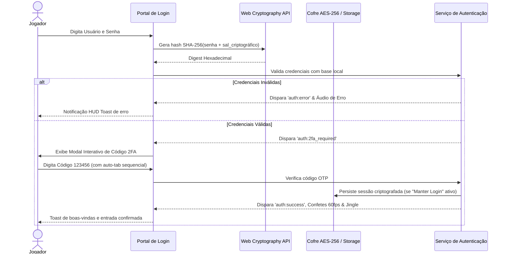
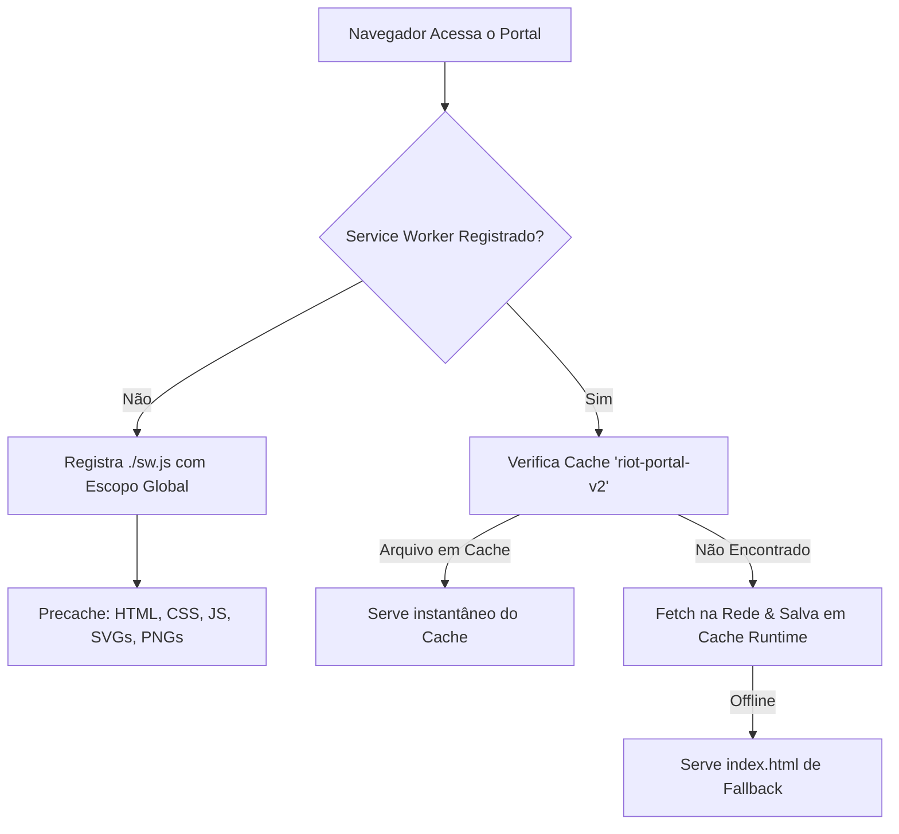
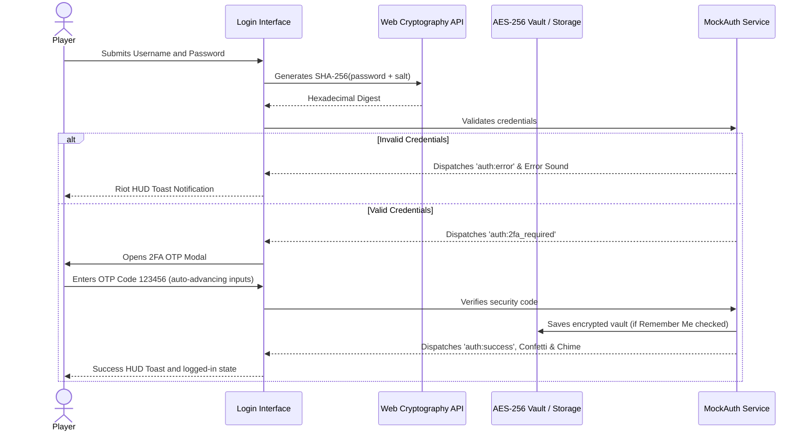
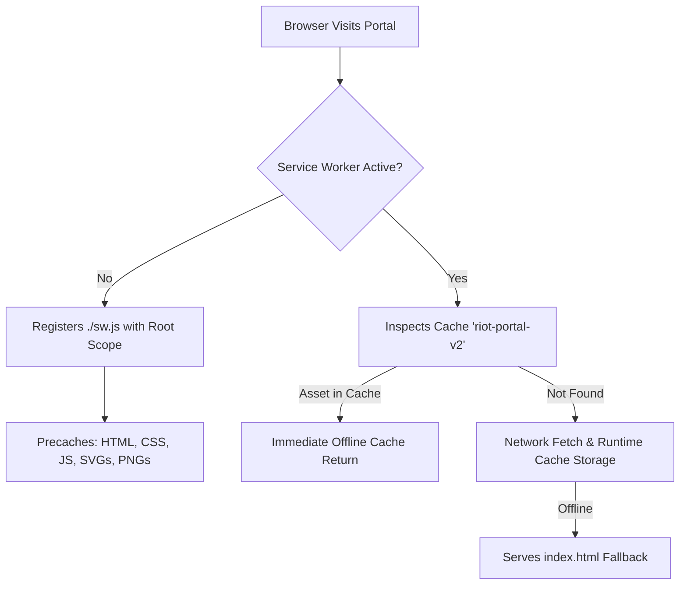

# 🎮 Riot Games Client — Portal de Autenticação & Esports Suite
### *Ultra-Realistic Client Simulation, Canvas 60fps VFX Engine, Web Audio Synthesizer & PWA*

[](https://github.com)
[](manifest.json)
[-brightgreen?style=for-the-badge)](package.json)
[](js/audio.js)
[](js/mock-auth.js)
[](styles/themes.css)
[](js/i18n.js)

---

## 🌐 Bilingual Documentation / Documentação Bilíngue
* [🇧🇷 Versão em Português](#-versão-em-português)
* [🇺🇸 English Version](#-english-version)

---

# 🇧🇷 Versão em Português

## 📋 Sumário Executivo
1. [Visão Geral & Filosofia Zero-Dependency](#1-visão-geral--filosofia-zero-dependency)
2. [Arquitetura de Software & Diagrama de Diretórios](#2-arquitetura-de-software--diagrama-de-diretórios)
3. [Os 6 Temas Oficiais da Riot Games](#3-os-6-temas-oficiais-da-riot-games)
4. [Especificação do Sintetizador Web Audio API](#4-especificação-do-sintetizador-web-audio-api)
5. [Motor de Partículas Canvas VFX & Emblemas Centrais](#5-motor-de-partículas-canvas-vfx--emblemas-centrais)
6. [Criptografia WebCrypto SHA-256 & Fluxo 2FA TOTP](#6-criptografia-webcrypto-sha-256--fluxo-2fa-totp)
7. [Treinador de Reflexos APM & Suite Bodyfit Esports](#7-treinador-de-reflexos-apm--suite-bodyfit-esports)
8. [Tabela de Atalhos de Teclado & Modo Imersivo](#8-tabela-de-atalhos-de-teclado--modo-imersivo)
9. [Instalação PWA & Guia do Service Worker (riot-portal-v2)](#9-instalação-pwa--guia-do-service-worker-riot-portal-v2)
10. [Como Executar Localmente & Deploy](#10-como-executar-localmente--deploy)

---

### 1. Visão Geral & Filosofia Zero-Dependency

O **Riot Games Client Portal** é uma recriação de altíssima fidelidade da interface oficial de login da Riot Games (League of Legends, Valorant, Teamfight Tactics, Star Guardian e K/DA), acompanhado pela suite biomecânica e de treino de reflexos **Bodyfit Esports Lab**.

#### ⚡ Princípios Fundamentais:
* **Zero Dependências Externas (Zero-Dependency)**: Nenhum framework (React, Vue, Angular), nenhum bundler pesado (Webpack, Vite), nenhuma biblioteca de terceiros no runtime central. 100% construído com tecnologias web nativas padronizadas pelo W3C.
* **Instant Cold-Start (<50ms)**: Carregamento instantâneo diretamente de disco (`file://`), servidor local ou CDN do GitHub Pages.
* **Áudio Procedural Puro (0KB MP3/WAV)**: Todos os efeitos sonoros são sintetizados matematicamente em tempo real via **Web Audio API** usando ondas senoidais, dente-de-serra e envelopes ADSR.
* **Resiliência Offline Total (PWA)**: O Service Worker com cache versionado (`riot-portal-v2`) armazena a aplicação inteira em cache, incluindo fontes Google Web Fonts em runtime.

---

### 2. Arquitetura de Software & Diagrama de Diretórios

O sistema opera sob uma arquitetura desacoplada e baseada em eventos (`CustomEvent` de barramento global `window`):

```
                        ┌───────────────────────────────┐
                        │      index.html / UI DOM      │
                        └───────┬───────────────┬───────┘
                                │               │
          ┌─────────────────────┼───────────────┼─────────────────────┐
          ▼                     ▼               ▼                     ▼
┌──────────────────┐  ┌──────────────────┐  ┌───────────────┐  ┌──────────────┐
│  ThemeSwitcher   │  │  ParticleEngine  │  │ RiotAudio     │  │ MockAuth &   │
│  (6 Universos)   │  │  (Canvas 60fps)  │  │ (Oscillator)  │  │ Security 2FA │
└─────────┬────────┘  └─────────┬────────┘  └───────┬───────┘  └──────┬───────┘
          │                     │                   │                 │
          ▼                     ▼                   ▼                 ▼
  CSS Variables         Thematic Reticles     ADSR Envelope    SHA-256 Hashing
  localStorage          Mouse Repulsion       Mute State       OTP 6 Dígitos
                        Vortex Attraction                      WebAuthn Passkey
                                                               Shard Pings
```

#### 📁 Estrutura de Diretórios:

```text
Tela-login-Riot/
├── index.html                   # Portal principal de autenticação de alta fidelidade
├── trembolona.html              # Interface de login retrô de alta performance
├── manifest.json                # Manifesto PWA completo (ícones 192px, 512px, maskable, shortcuts)
├── sw.js                        # Service Worker raiz (delega para js/sw.js com escopo global)
├── GH.css                       # Folha de estilos legada mantida para retrocompatibilidade
├── Durateston.js                # Controlador legado para compatibilidade com scripts antigos
├── assets/
│   ├── icons.js                 # Biblioteca de vetores SVG (Riot Fist, Google, Apple, Xbox, PS, etc.)
│   ├── icon.svg                 # Vetor mestre com o brasão e punho estilizado da Riot Games
│   ├── icon-192.png             # Ícone PWA 192x192 gerado em alta definição
│   ├── icon-512.png             # Ícone PWA 512x512 para splash screen
│   └── icon-maskable.png        # Ícone PWA 512x512 adaptativo com área segura (maskable)
├── js/
│   ├── audio.js                 # Motor sintetizador de som procedural (Web Audio API)
│   ├── auth.js                  # Controladores de input flutuante, validações e detecção de Caps Lock
│   ├── confetti.js              # Canhão procedural de partículas de confete para celebração de login
│   ├── Durateston.js            # Módulo modularizado de compatibilidade do formulário
│   ├── i18n.js                  # Engine de internacionalização dinâmica em tempo real (5 idiomas)
│   ├── mock-auth.js             # Autenticação segura com WebCrypto SHA-256, 2FA OTP e sessão
│   ├── particles.js             # Motor Canvas VFX 60fps com 6 emblemas dinâmicos e física vetorial
│   ├── riot-security.js         # Módulo de segurança: Captcha deslizante, Passkeys WebAuthn e Shards
│   ├── shortcuts.js             # Gerenciador global de atalhos de teclado e notificações HUD Toast
│   ├── sw.js                    # Service Worker modular com versionamento 'riot-portal-v2'
│   └── theme-switcher.js        # Alternador dinâmico de 6 temas com persistência em localStorage
├── styles/
│   ├── account-settings.css     # Estilos modernos para a central de configurações e segurança
│   ├── animations.css           # Keyframes de micro-interações, pulso, rotações e transições
│   ├── GH.css                   # Folha de estilo base do cliente com variáveis CSS integradas
│   └── themes.css               # Especificação visual, gradientes e paletas dos 6 universos
├── bodyfit/                     # Suite Biomecânica & Laboratório de Treino de Reflexos Esports
│   ├── index.html               # Aplicação web completa: APM Trainer, Reflexômetro e Calculadoras
│   ├── Creatina.js              # Engine JavaScript de latência motora, APM, IMC, TMB e Áudio
│   ├── Termogenico.css          # Estilização Dark Cyberpunk / Neon Green para alta performance
│   └── Logo.png                 # Logotipo oficial da Bodyfit Esports Lab
└── .github/
    └── workflows/
        └── deploy.yml           # Pipeline CI/CD automático para deploy no GitHub Pages
```

---

### 3. Os 6 Temas Oficiais da Riot Games

O portal conta com 6 temas imersivos dos jogos e universos da Riot Games, acionados dinamicamente via seletor no cabeçalho ou pelo atalho `Alt + T`:

| Identificador | Universo / Jogo | Cor Primária | Cor de Realce | Atmosfera Visual & Gradiente de Fundo |
|---|---|---|---|---|
| `riot` | **Riot Games Core** *(Padrão)* | `#EB0029` (Rubi Riot) | `#FF4655` | Gradiente escuro minimalista (`#0F1016` → `#181925`), brasas avermelhadas. |
| `valorant` | **Valorant Tactical** | `#FF4655` (Crimson Radiante) | `#00F5D4` / `#ECE8E1` | Preto espacial e ardósia tática (`#0F1923` → `#1F2731`), retículos de mira HUD. |
| `lol` | **League of Legends** | `#C8AA6D` (Ouro Hextech) | `#0AC8B9` (Arcano) | Azul abissal e runas douradas de Piltover (`#010A10` → `#0A1428`). |
| `tft` | **Teamfight Tactics** | `#9D4EDD` (Roxo Cósmico) | `#4CC9F0` (Estelar) | Tons místicos de galáxia (`#13092D` → `#24144D`), anéis orbitais e poeira estelar. |
| `star-guardian` | **Star Guardian** | `#FF66B2` (Rosa Guardiã) | `#FFD700` (Ouro Estelar) | Atmosfera mágica crepuscular (`#1A0A2A` → `#32103D`), faíscas brilhantes de luz. |
| `kda` | **K/DA Cyber Pop** | `#C7007D` (Magenta Neon) | `#00F0FF` (Ciano Laser) | Futurismo pop prismático (`#0D021A` → `#1A062F`), reflexos de cristais cortantes. |

---

### 4. Especificação do Sintetizador Web Audio API

O arquivo [`js/audio.js`](js/audio.js) elimina totalmente o uso de arquivos `.mp3` ou `.ogg`, sintetizando cada evento sonoro diretamente pela placa de som do usuário via código:

* **Click Tátil (`playClick`)**:
  * *Onda*: Senoidal (`sine`)
  * *Pitch Drop*: $800\text{ Hz} \to 300\text{ Hz}$ em 50ms
  * *Envelope*: Ataque instantâneo, decaimento exponencial ($0.12 \to 0.001$).
* **Foco em Campo (`playFocus`)**:
  * *Onda*: Triangular (`triangle`)
  * *Frequência*: $1200\text{ Hz}$ ultra-suave por 30ms com ganho de $0.06$.
* **Passar o Mouse / Hover (`playHover`)**:
  * *Onda*: Senoidal (`sine`)
  * *Pitch Glissando*: $400\text{ Hz} \to 650\text{ Hz}$ em 40ms.
* **Transição de Tema / Whoosh (`playWhoosh`)**:
  * *Onda*: Senoidal combinada com filtro biquad passa-baixa (`lowpass` $1200\text{ Hz} \to 200\text{ Hz}$).
  * *Duração*: 250ms com decaimento suave.
* **Sucesso / Login Arpeggio (`playSuccess`)**:
  * *Acorde Quádruplo*: Notas musicais $C_5$ ($523.25\text{ Hz}$), $E_5$ ($659.25\text{ Hz}$), $G_5$ ($783.99\text{ Hz}$), $C_6$ ($1046.50\text{ Hz}$).
  * *Deslocamento*: $80\text{ms}$ por nota, gerando o clássico jingle triunfante da Riot.
* **Alerta de Erro (`playError`)**:
  * *Onda*: Dente-de-serra (`sawtooth`) filtrada em $400\text{ Hz}$.
  * *Frequência*: Queda de $160\text{ Hz} \to 110\text{ Hz}$ em 200ms produzindo um impacto grave e abafado.
* **Persistência de Mudo**: Estado salvo em `localStorage.getItem('riot_audio_muted')`, com atalho rápido `Ctrl + M`.

---

### 5. Motor de Partículas Canvas VFX & Emblemas Centrais

Em [`js/particles.js`](js/particles.js), um motor 2D renderiza a 60 frames por segundo no wallpaper de fundo com adaptação total ao tema ativo:

#### 🌟 Emblemas Dinâmicos no Centro do Wallpaper:
1. **Riot Games**: Brasão hexagonal de proteção com pulsação harmônica e escudo de força interno.
2. **Valorant**: Retículo tático militar com rotação em eixos cruzados, marcações de mira e radar animado.
3. **League of Legends**: Anéis rúnicos concêntricos girando em direções opostas com linhas tracejadas e gema Hextech central.
4. **Teamfight Tactics**: Elipses orbitais cósmicas inclinadas em ângulo giroscópico com poeira galáctica.
5. **Star Guardian**: Estrela mágica de 4 pontas com anel de luz cintilante e pulso celestial.
6. **K/DA**: Prisma de diamante multifacetado com varredura de laser neon ciano e magenta.

#### 🧲 Física Interativa com o Cursor:
* **Repulsão por Proximidade**: Partículas desviam suavemente da posição do mouse num raio de 140 pixels.
* **Atração Gravitacional (Mousedown)**: Segurar o botão esquerdo do mouse atrai partículas num vórtice espiral para o cursor.
* **Impacto Shockwave (Click)**: Um anel de choque dispersa as partículas ao redor com desaceleração inercial.
* **Economia de Recursos**: Pausa automática do `requestAnimationFrame` através do evento `visibilitychange` quando a aba fica inativa.

---

### 6. Criptografia WebCrypto SHA-256 & Fluxo 2FA TOTP

Desenvolvido em [`js/mock-auth.js`](js/mock-auth.js) e [`js/riot-security.js`](js/riot-security.js):



#### 🛡️ Recursos Avançados de Segurança:
* **WebAuthn Biometric Passkeys**: Suporte à API nativa `navigator.credentials` para autenticação biométrica via Windows Hello, TouchID ou chave física de segurança.
* **Desafio Anti-Bot de Captcha Deslizante**: Modal interativo que exige encaixe milimétrico de peça de quebra-cabeça com cálculo de tolerância vetorial antes de autorizar logins suspeitos.
* **Seletor de Shard & Região com Ping ao Vivo**: Indicador em tempo real de latência e tickrate (128-tick) para servidores BR, NA, EUW, EUNE, KR, JP, LAN, LAS e OCE.

---

### 7. Treinador de Reflexos APM & Suite Bodyfit Esports

Acessível em [`bodyfit/index.html`](bodyfit/index.html) ou pelo atalho no portal:

1. **APM Reflex & Click Speed Trainer (10 Segundos)**:
   * **Modo Velocidade**: Medição contínua de cliques brutos por minuto.
   * **Modo Precisão**: Surgimento dinâmico de alvos com coordenadas aleatórias na arena.
   * **Tabela de Ranques Competitivos**:
     * 🏆 **Desafiante (Challenger)**: $\ge 350\text{ APM}$
     * 💎 **Grão-Mestre (Grandmaster)**: $240 \text{ a } 349\text{ APM}$
     * 🥇 **Diamante (Diamond)**: $160 \text{ a } 239\text{ APM}$
     * 🥈 **Ouro (Gold)**: $100 \text{ a } 159\text{ APM}$
     * 🥉 **Ferro (Iron)**: $< 100\text{ APM}$
2. **Reflexômetro Visual de Milissegundos**:
   * Tela de espera em Vermelho $\to$ Mudança relâmpago para Verde $\to$ Clique rápido.
   * Mede latência motora exata contra benchmarks de jogadores profissionais (Faker / TenZ tier $< 180\text{ms}$).
3. **Alerta de Pausa Ativa & Ergonomia Gamer (Regra 20-20-20)**:
   * Temporizador configurável (30m, 45m, 60m) com lembrete sonoro para evitar lesões por esforço repetitivo (LER) e síndrome do túnel do carpo.
4. **Calculadoras Biométricas do Cyberatleta**:
   * **Calculadora de IMC**: Diagnóstico corporal interativo.
   * **Consumo Hídrico Diário**: Meta de hidratação baseada no peso corporal.
   * **Taxa Metabólica Basal (TMB)**: Fórmula de Harris-Benedict adaptada.

---

### 8. Tabela de Atalhos de Teclado & Modo Imersivo

| Tecla de Atalho | Ação Executada | Módulo Responsável |
|---|---|---|
| <kbd>Alt</kbd> + <kbd>T</kbd> | Alterna ciclicamente entre os 6 temas da Riot Games | [`shortcuts.js`](js/shortcuts.js) |
| <kbd>Alt</kbd> + <kbd>L</kbd> | Alterna ciclicamente entre os 5 idiomas suportados | [`i18n.js`](js/i18n.js) |
| <kbd>Ctrl</kbd> + <kbd>M</kbd> / <kbd>Cmd</kbd> + <kbd>M</kbd> | Ativa / Desativa o sintetizador sonoro (Mudo) | [`audio.js`](js/audio.js) |
| <kbd>F11</kbd> ou Botão `⛶` | Alterna o modo de Tela Cheia Imersiva | Fullscreen API |
| <kbd>Esc</kbd> | Fecha imediatamente qualquer modal aberto (2FA, Captcha, Ajuda) | [`shortcuts.js`](js/shortcuts.js) |
| <kbd>Tab</kbd> / <kbd>Shift + Tab</kbd> | Navegação acessível e sequencial entre campos de formulário | HTML5 Nativo |
| <kbd>Enter</kbd> | Submete formulário de autenticação ou confirma código OTP | [`auth.js`](js/auth.js) |

---

### 9. Instalação PWA & Guia do Service Worker (riot-portal-v2)

O portal é um **Progressive Web App (PWA)** de Classe A:



#### 📲 Passos para Instalação no Dispositivo:
* **Google Chrome / Microsoft Edge (Desktop)**:
  1. Clique no ícone de computador/instalação presente no canto direito da barra de navegação (ou acesse `Menu` $\to$ `Instalar Riot Client`).
  2. O cliente passará a abrir em janela própria independente, sem bordas de navegador, idêntico a um aplicativo de desktop instalado.
* **Android (Chrome)**:
  1. Toque no banner inferior *"Adicionar Riot Client à tela inicial"* ou abra o menu de três pontos e selecione *"Instalar aplicativo"*.
* **iOS (Safari)**:
  1. Toque no botão de Compartilhamento do Safari.
  2. Selecione a opção *"Adicionar à Tela de Início"*.
* **Como testar o funcionamento offline**:
  1. Abra o DevTools do navegador (<kbd>F12</kbd>).
  2. Vá na aba **Application** $\to$ **Service Workers** e confirme que o status está ativo com cache `riot-portal-v2`.
  3. Vá na aba **Network**, marque a opção **Offline** e recarregue a página (<kbd>F5</kbd>). A página funcionará integralmente com sons, partículas e autenticação local.

---

### 10. Como Executar Localmente & Deploy

Como o projeto segue a filosofia **Zero-Dependency**, nenhuma instalação de pacotes `npm install` é necessária:

1. **Execução Direta**:
   * Basta dar duplo clique no arquivo [`index.html`](index.html) em qualquer navegador moderno.
2. **Execução com Servidor HTTP Local (Recomendado para testar PWA)**:
   ```bash
   # Opção A: Usando Python 3
   python -m http.server 8080

   # Opção B: Usando Node.js npx
   npx serve .

   # Opção C: Usando extensão Live Server no VS Code
   ```
   Acesse no navegador: `http://localhost:8080`.

3. **Deploy Contínuo no GitHub Pages**:
   * O repositório já inclui o workflow [`.github/workflows/deploy.yml`](.github/workflows/deploy.yml) configurado. Basta fazer push para o branch `main` e o site será publicado automaticamente.

---

<br><br>

---

# 🇺🇸 English Version

## 📋 Table of Contents
1. [Overview & Zero-Dependency Philosophy](#1-overview--zero-dependency-philosophy)
2. [Software Architecture & Directory Diagram](#2-software-architecture--directory-diagram)
3. [The 6 Official Riot Games Themes](#3-the-6-official-riot-games-themes)
4. [Web Audio API Synthesizer Specification](#4-web-audio-api-synthesizer-specification)
5. [Canvas Particle VFX Engine & Thematic Centerpieces](#5-canvas-particle-vfx-engine--thematic-centerpieces)
6. [WebCrypto SHA-256 Hashing & 2FA TOTP Workflow](#6-webcrypto-sha-256-hashing--2fa-totp-workflow)
7. [APM Reflex Trainer & Bodyfit Esports Suite](#7-apm-reflex-trainer--bodyfit-esports-suite)
8. [Keyboard Shortcuts Cheatsheet & Immersive Mode](#8-keyboard-shortcuts-cheatsheet--immersive-mode)
9. [PWA Installation & Service Worker (riot-portal-v2)](#9-pwa-installation--service-worker-riot-portal-v2)
10. [Local Execution & Deployment](#10-local-execution--deployment)

---

### 1. Overview & Zero-Dependency Philosophy

The **Riot Games Client Portal** is an ultra-realistic, immersive simulation of the official Riot Games login screen (League of Legends, Valorant, Teamfight Tactics, Star Guardian, and K/DA), bundled with the **Bodyfit Esports Lab** biomechanics and reaction training suite.

#### ⚡ Core Principles:
* **Zero External Dependencies**: No frameworks (React, Vue, Angular), no heavy build tools (Webpack, Vite), no third-party runtime scripts. Built 100% on native W3C open web standards.
* **Instant Cold-Start (<50ms)**: Zero compilation delay. Runs directly from disk (`file://`), any local server, or GitHub Pages.
* **Pure Procedural Audio (0KB MP3/WAV)**: Every sound effect is synthesized procedurally in real-time through the **Web Audio API** using sine waves, triangle waves, sawtooth oscillators, and custom ADSR envelopes.
* **Full Offline Resiliency (PWA)**: Service Worker with cache versioning (`riot-portal-v2`) guarantees complete offline availability, including runtime caching for Google Fonts.

---

### 2. Software Architecture & Directory Diagram

The application leverages an event-driven decoupled architecture (`CustomEvent` on the global `window` bus):

```
                        ┌───────────────────────────────┐
                        │      index.html / UI DOM      │
                        └───────┬───────────────┬───────┘
                                │               │
          ┌─────────────────────┼───────────────┼─────────────────────┐
          ▼                     ▼               ▼                     ▼
┌──────────────────┐  ┌──────────────────┐  ┌───────────────┐  ┌──────────────┐
│  ThemeSwitcher   │  │  ParticleEngine  │  │ RiotAudio     │  │ MockAuth &   │
│  (6 Universes)   │  │  (Canvas 60fps)  │  │ (Oscillator)  │  │ Security 2FA │
└─────────┬────────┘  └─────────┬────────┘  └───────┬───────┘  └──────┬───────┘
          │                     │                   │                 │
          ▼                     ▼                   ▼                 ▼
  CSS Variables         Thematic Reticles     ADSR Envelope    SHA-256 Hashing
  localStorage          Mouse Repulsion       Mute State       6-Digit OTP
                        Vortex Attraction                      WebAuthn Passkey
                                                               Shard Latencies
```

#### 📁 Repository File Tree:

```text
Tela-login-Riot/
├── index.html                   # Master login portal with complete animations and HUD
├── trembolona.html              # High-performance lightweight retro login UI
├── manifest.json                # PWA manifest (192px, 512px, maskable icons & shortcuts)
├── sw.js                        # Root Service Worker forwarder with global scope
├── GH.css                       # Root base stylesheet for backward compatibility
├── Durateston.js                # Legacy form interaction script for compatibility
├── assets/
│   ├── icons.js                 # High-precision SVG vectors (Riot Fist, Google, Apple, etc.)
│   ├── icon.svg                 # Scalable master SVG with official Riot fist geometry
│   ├── icon-192.png             # Crisp 192x192 PWA home screen icon
│   ├── icon-512.png             # High-DPI 512x512 splash screen icon
│   └── icon-maskable.png        # Adaptive 512x512 maskable icon with safe zone
├── js/
│   ├── audio.js                 # Procedural sound synthesizer engine (Web Audio API)
│   ├── auth.js                  # Floating labels, Caps Lock detector & validation logic
│   ├── confetti.js              # Canvas confetti cannon for successful authentications
│   ├── Durateston.js            # Modular form listener module
│   ├── i18n.js                  # Dynamic client-side internationalization (5 languages)
│   ├── mock-auth.js             # WebCrypto SHA-256 hashing, 2FA OTP, and session manager
│   ├── particles.js             # Canvas 60fps VFX engine with 6 dynamic centerpieces
│   ├── riot-security.js         # Sliding puzzle captcha, WebAuthn Passkeys & Shard selector
│   ├── shortcuts.js             # Global keyboard shortcuts dispatcher & HUD Toast manager
│   ├── sw.js                    # Modular Service Worker with 'riot-portal-v2' cache strategy
│   └── theme-switcher.js        # Dynamic 6-theme switcher with localStorage persistence
├── styles/
│   ├── account-settings.css     # Modern styling for security and account management
│   ├── animations.css           # Micro-interaction keyframes, pulses, and transitions
│   ├── GH.css                   # Core client stylesheet with dynamic CSS custom properties
│   └── themes.css               # Visual tokens, gradients, and palettes for all 6 universes
├── bodyfit/                     # Biomechanics Suite & Esports Reflex Training Lab
│   ├── index.html               # Dedicated web app: APM Trainer, Latency Timer & Calculators
│   ├── Creatina.js              # High-precision engine for APM, Reaction Time, BMI & BMR
│   ├── Termogenico.css          # Dark Cyberpunk / Neon Green aesthetic stylesheet
│   └── Logo.png                 # Official Bodyfit Esports Lab insignia
└── .github/
    └── workflows/
        └── deploy.yml           # Automated CI/CD pipeline for GitHub Pages static hosting
```

---

### 3. The 6 Official Riot Games Themes

Switch instantaneously between Riot's iconic universes via the top-right selector or using the shortcut `Alt + T`:

| Theme Key | Universe / Game | Primary Color | Accent Color | Visual Identity & Wallpaper Background |
|---|---|---|---|---|
| `riot` | **Riot Games Core** *(Default)* | `#EB0029` (Riot Crimson) | `#FF4655` | Minimalist dark gradient (`#0F1016` → `#181925`), floating crimson embers. |
| `valorant` | **Valorant Tactical** | `#FF4655` (Radiant Red) | `#00F5D4` / `#ECE8E1` | Matte dark slate (`#0F1923` → `#1F2731`), tactical radar reticles & crosshairs. |
| `lol` | **League of Legends** | `#C8AA6D` (Hextech Gold) | `#0AC8B9` (Arcane Cyan) | Abyssal blue and ancient runes (`#010A10` → `#0A1428`), rotating magical rings. |
| `tft` | **Teamfight Tactics** | `#9D4EDD` (Cosmic Violet) | `#4CC9F0` (Stellar Blue) | Deep celestial space (`#13092D` → `#24144D`), gyroscopic orbital galaxy rings. |
| `star-guardian` | **Star Guardian** | `#FF66B2` (Guardian Pink) | `#FFD700` (Starlight Gold)| Magical twilight aesthetic (`#1A0A2A` → `#32103D`), glittering light sparkles. |
| `kda` | **K/DA Cyber Pop** | `#C7007D` (Neon Magenta) | `#00F0FF` (Laser Cyan) | Prismatic pop futurism (`#0D021A` → `#1A062F`), faceted crystal prism refraction. |

---

### 4. Web Audio API Synthesizer Specification

Implemented in [`js/audio.js`](js/audio.js), synthesizing all audio procedural cues directly through mathematical formulas without loading external audio files:

* **Tactile Click (`playClick`)**:
  * *Oscillator*: Sine wave (`sine`)
  * *Pitch Drop*: $800\text{ Hz} \to 300\text{ Hz}$ across 50ms
  * *Envelope*: Instant attack, exponential release ($0.12 \to 0.001$).
* **Input Focus (`playFocus`)**:
  * *Oscillator*: Triangle wave (`triangle`)
  * *Frequency*: $1200\text{ Hz}$ subtle ping for 30ms with gain of $0.06$.
* **Button Hover (`playHover`)**:
  * *Oscillator*: Sine wave (`sine`)
  * *Pitch Glissando*: $400\text{ Hz} \to 650\text{ Hz}$ across 40ms.
* **Theme Transition / Whoosh (`playWhoosh`)**:
  * *Oscillator*: Low-frequency sine coupled with a biquad lowpass filter sweep ($1200\text{ Hz} \to 200\text{ Hz}$).
  * *Duration*: 250ms with smooth fade-out.
* **Victory / Login Arpeggio (`playSuccess`)**:
  * *Four-Note Chime*: Musical notes $C_5$ ($523.25\text{ Hz}$), $E_5$ ($659.25\text{ Hz}$), $G_5$ ($783.99\text{ Hz}$), $C_6$ ($1046.50\text{ Hz}$).
  * *Interval*: $80\text{ms}$ delay per note, delivering Riot's iconic triumphant authentication cue.
* **Error Warning (`playError`)**:
  * *Oscillator*: Sawtooth wave (`sawtooth`) routed through a $400\text{ Hz}$ lowpass filter.
  * *Frequency*: Rapid pitch drop $160\text{ Hz} \to 110\text{ Hz}$ in 200ms generating a heavy, muffled thud.
* **Mute Persistence**: State saved in `localStorage.getItem('riot_audio_muted')`, accessible via shortcut `Ctrl + M`.

---

### 5. Canvas Particle VFX Engine & Thematic Centerpieces

In [`js/particles.js`](js/particles.js), a 60fps canvas engine renders behind the login card, dynamically mirroring the chosen game theme:

#### 🌟 Custom Thematic Centerpieces:
1. **Riot Games**: Geometric Hexagonal Shield with harmonic pulsing and internal defense crest.
2. **Valorant**: Tactical Radar Reticle with 360° counter-rotating crosshairs and animated target sweep.
3. **League of Legends**: Concentric Hextech Runic Rings spinning in opposite directions with dashed glyph lines and glowing arcane core.
4. **Teamfight Tactics**: Dual 3D-inclined gyroscopic galaxy rings with cosmic orbital stardust.
5. **Star Guardian**: 4-point magical starlight gem surrounded by an iridescent halo ring.
6. **K/DA**: Diamond-faceted geometric prism with dynamic cyan and magenta laser sweeps.

#### 🧲 Cursor Physics & Interactions:
* **Proximity Repulsion**: Particles smoothly scatter when approaching the mouse cursor within 140px.
* **Gravitational Vortex (Mousedown)**: Holding the left mouse button collapses particles inward in a spiral vortex.
* **Shockwave Impulse (Click)**: Clicking fires an outward kinetic shockwave dispersing nearby motes.
* **Battery & GPU Optimization**: Automatically pauses `requestAnimationFrame` on tab blur via `document.visibilityState`.

---

### 6. WebCrypto SHA-256 Hashing & 2FA TOTP Workflow

Engineered in [`js/mock-auth.js`](js/mock-auth.js) and [`js/riot-security.js`](js/riot-security.js):



#### 🛡️ Advanced Security Modules:
* **Biometric WebAuthn Passkeys**: Native `navigator.credentials` integration for seamless biometric authentication with TouchID, FaceID, or Windows Hello.
* **Sliding Puzzle Anti-Bot Captcha**: Interactive challenge widget demanding precise vector piece alignment before verifying suspicious authentications.
* **Global Shard & Region Latency Monitor**: Real-time ping and 128-tickrate monitor across BR, NA, EUW, EUNE, KR, JP, LAN, LAS, and OCE game servers.

---

### 7. APM Reflex Trainer & Bodyfit Esports Suite

Available directly in [`bodyfit/index.html`](bodyfit/index.html):

1. **APM Reflex & Precision Trainer (10-Second Challenge)**:
   * **Speed Mode**: Raw click frequency tester measuring actions per minute.
   * **Precision Mode**: Randomly appearing Hextech targets testing motor coordination.
   * **Rank Tiers**:
     * 🏆 **Challenger**: $\ge 350\text{ APM}$
     * 💎 **Grandmaster**: $240 \text{ to } 349\text{ APM}$
     * 🥇 **Diamond**: $160 \text{ to } 239\text{ APM}$
     * 🥈 **Gold**: $100 \text{ to } 159\text{ APM}$
     * 🥉 **Iron**: $< 100\text{ APM}$
2. **Visual Reaction Latency Timer**:
   * Wait Screen (Red) $\to$ Instant Flash (Green) $\to$ Fast Click.
   * Benchmarks exact latency against esports pro records (Faker / TenZ tier $< 180\text{ms}$).
3. **Ergonomic Break Timer (20-20-20 Rule)**:
   * Configurable countdown (30m, 45m, 60m) with acoustic alert reminders to prevent eye strain and carpal tunnel syndrome.
4. **Esports Biometric Calculators**:
   * **BMI / IMC Calculator**: Visual body composition gauge.
   * **Daily Hydration Requirement**: Water intake target tailored to body weight.
   * **Basal Metabolic Rate (BMR)**: Harris-Benedict formula for cognitive performance.

---

### 8. Keyboard Shortcuts Cheatsheet & Immersive Mode

| Shortcut Key | Action Triggered | Handler Module |
|---|---|---|
| <kbd>Alt</kbd> + <kbd>T</kbd> | Cycle through all 6 Riot Gaming themes | [`shortcuts.js`](js/shortcuts.js) |
| <kbd>Alt</kbd> + <kbd>L</kbd> | Cycle through all 5 supported languages | [`i18n.js`](js/i18n.js) |
| <kbd>Ctrl</kbd> + <kbd>M</kbd> / <kbd>Cmd</kbd> + <kbd>M</kbd> | Toggle Web Audio Synthesizer mute state | [`audio.js`](js/audio.js) |
| <kbd>F11</kbd> or `⛶` Button | Toggle Fullscreen Immersive Mode | Fullscreen API |
| <kbd>Esc</kbd> | Close any active modal dialog (2FA, Captcha, Help) | [`shortcuts.js`](js/shortcuts.js) |
| <kbd>Tab</kbd> / <kbd>Shift + Tab</kbd> | Sequential accessible focus navigation between inputs | Native HTML5 |
| <kbd>Enter</kbd> | Submit authentication form or confirm OTP verification | [`auth.js`](js/auth.js) |

---

### 9. PWA Installation & Service Worker (riot-portal-v2)

The application fulfills all criteria for a Tier-1 **Progressive Web App (PWA)**:



#### 📲 Step-by-Step Installation:
* **Google Chrome / Microsoft Edge (Desktop)**:
  1. Click the install icon in the address bar (or navigate to `Menu` $\to$ `Install Riot Client`).
  2. The portal launches in a dedicated window without browser chrome, identical to an installed native desktop client.
* **Android (Chrome)**:
  1. Tap the *"Add Riot Client to Home Screen"* banner or select *"Install App"* from the overflow menu.
* **iOS (Safari)**:
  1. Tap the Share button in Safari.
  2. Select *"Add to Home Screen"*.
* **Verifying Offline Operation**:
  1. Open DevTools (<kbd>F12</kbd>).
  2. In the **Application** tab, confirm that the Service Worker is active with cache name `riot-portal-v2`.
  3. Under the **Network** tab, toggle **Offline** and refresh (<kbd>F5</kbd>). The portal loads immediately with full animations, procedural audio, and local authentication.

---

### 10. Local Execution & Deployment

Adhering strictly to the **Zero-Dependency** design, no `npm install` or compilation step is required:

1. **Direct Launch**:
   * Double-click [`index.html`](index.html) in any modern web browser.
2. **Local HTTP Server (Recommended for PWA testing)**:
   ```bash
   # Option A: Python 3
   python -m http.server 8080

   # Option B: Node.js npx
   npx serve .

   # Option C: VS Code Live Server extension
   ```
   Open `http://localhost:8080` in your browser.

3. **Continuous Deployment via GitHub Pages**:
   * The automated workflow [`.github/workflows/deploy.yml`](.github/workflows/deploy.yml) deploys the root directory on push to `main`.

---

<p align="center">
  <b>Riot Games Client Simulation &amp; Bodyfit Esports Suite</b> • <i>Engineered with 100% Pure Vanilla Web Technologies</i>
</p>
